<div align="center">



<br/>

<a href="https://github.com/BhunZ?tab=repositories"></a>
<a href="https://github.com/BhunZ/StatStriker"></a>


</div>

<br/>


<br/><br/>


<table align="center">
  <tr>
    <td width="50%"><a href="https://github.com/BhunZ/StatStriker"></a></td>
    <td width="50%"><a href="https://github.com/BhunZ/Vietnam-Data-Job-Market-Analysis"></a></td>
  </tr>
  <tr>
    <td width="50%"><a href="https://github.com/BhunZ/binance-market-pipeline"></a></td>
    <td width="50%"><a href="https://github.com/BhunZ/stanford-nlp-tutor"></a></td>
  </tr>
  <tr>
    <td width="50%"><a href="https://github.com/BhunZ/a8-hbt-datathon-the_gridbreaker"></a></td>
    <td width="50%"><a href="https://github.com/BhunZ/football-match-prediction-poisson"></a></td>
  </tr>
</table>

<br/>




<br/><br/>






<br/><br/>


<details>
<summary><code>▸ SELECT * FROM bhunz.secrets;</code> <sub>← click to run</sub></summary>

```json
{
  "status": 200,
  "data": {
    "availability": "Open to internships & collaborations",
    "mark": "bh + a star. My real signature stays on paper",
    "hobbies": ["Football analytics", "Datathons", "Automating chores"],
    "favorite_stack": ["DuckDB", "Airflow", "FastAPI"],
    "rule_of_thumb": "If a number can be wrong, write a test for it"
  }
}
```

<sub>✓ 1 row returned in 0.042s</sub>

</details>

<br/>


<!-- Ink & Signal · every SVG here is generated by generate.py and refreshed daily by .github/workflows/refresh.yml -->
